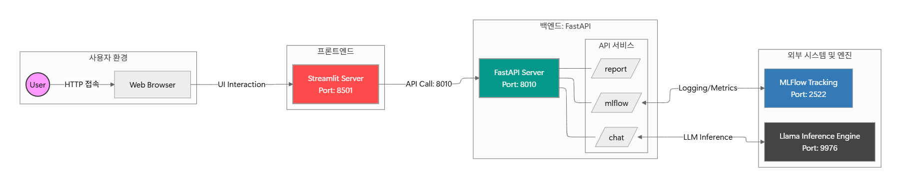
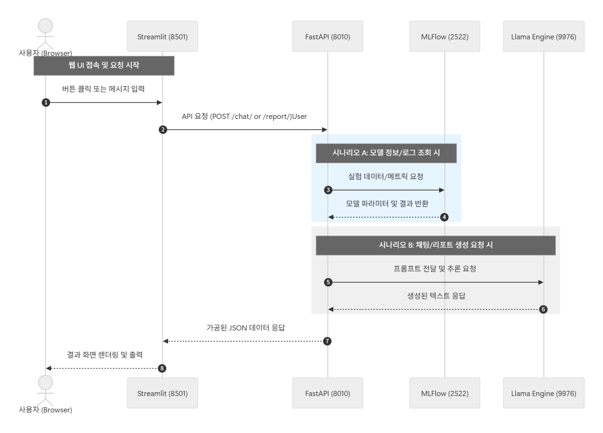

# mlflow_LLM_dy

MLflow 실험 데이터를 조회하고, LLM 기반 보고서 생성 및 Q&A를 제공하는 프로젝트입니다.

## 시스템 아키텍처 다이어그램



## 시퀀스 다이어그램



## 네트워크/포트 맵핑 정보
- `backend`: FastAPI API 서버
- `frontend`: Streamlit UI
- `docker-compose.yml`: Docker 통합 실행 설정
- MLflow: v3.11.1 (:2522)
- LLM
  - Qwen3.6 (:9978)
  - gemma-4 (:9976)


## How-to-Run

### 1) docker 빌드 및 실행
프로젝트 루트에서 실행:

```bash
docker compose build
docker compose up -d
```

### 2) 동작 확인

- Backend health check: `http://localhost:8010/health`
- Frontend (Streamlit): `http://localhost:8501`

### 3) 종료

```bash
docker compose down
```

## API 요약

- MLflow API
  - `GET /mlflow/names`
  - `GET /mlflow/experiment`
  - `GET /mlflow/runs`
  - `GET /mlflow/top-runs`
  - `GET /mlflow/metric-keys`
- Report API
  - `POST /report/`
- Chat API
  - `POST /chat/ask`

