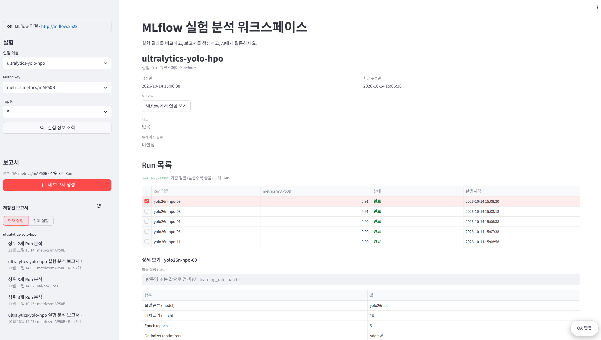
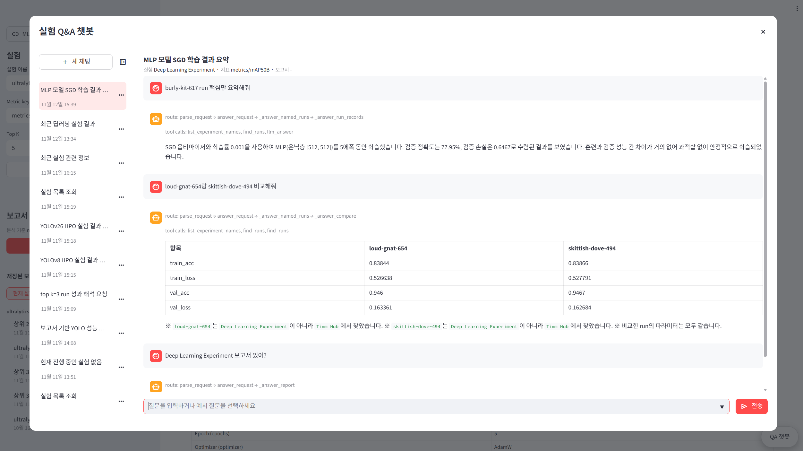
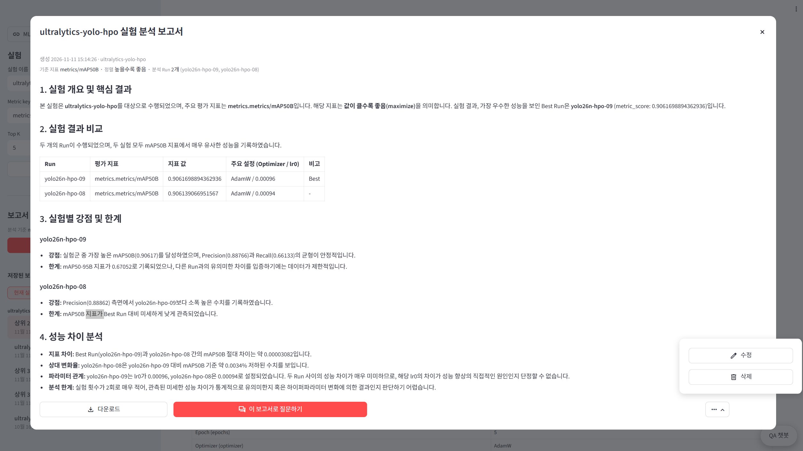
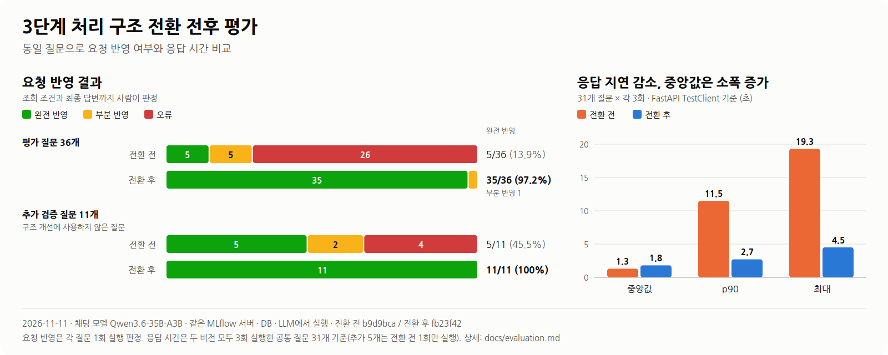
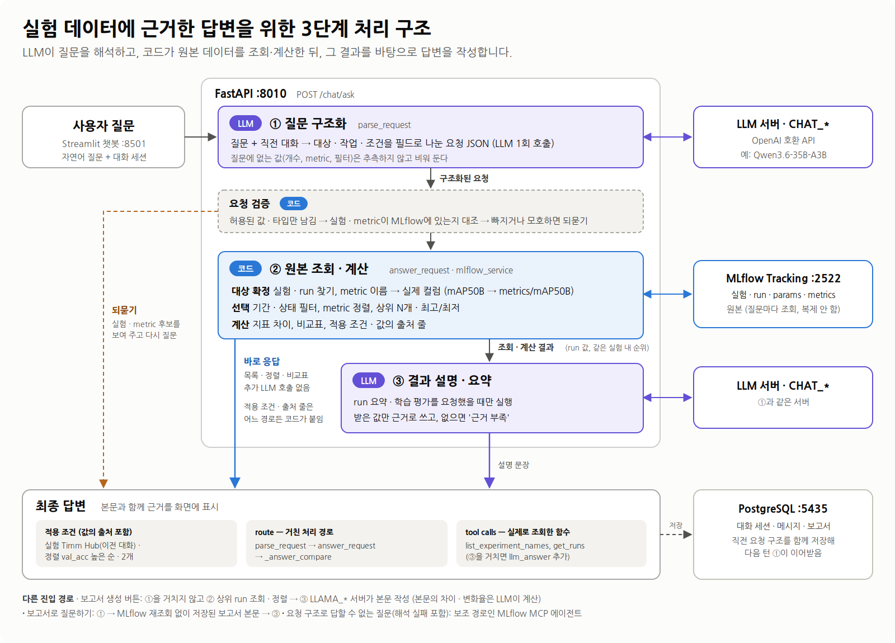
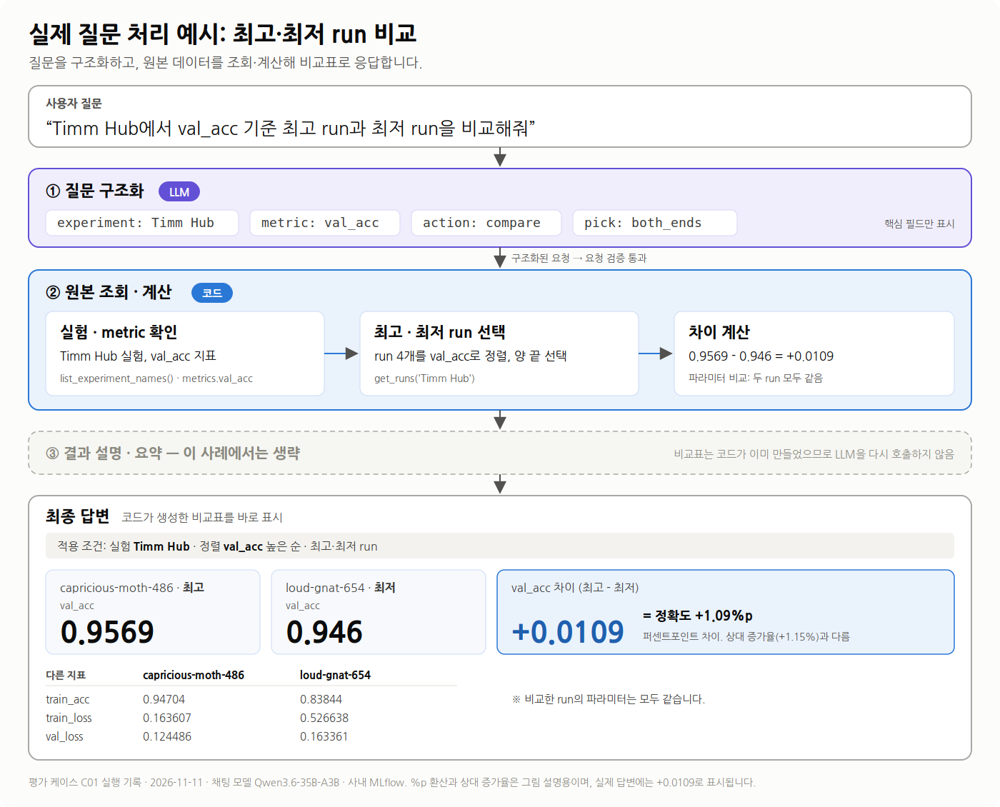

# MLflow Experiment QA Agent

## 목차

- [해결하려는 문제](#해결하려는-문제)
- [주요 기능과 사용 예시](#주요-기능과-사용-예시)
- [구조 개선 전후 평가](#구조-개선-전후-평가)
- [동작 구조와 핵심 설계](#동작-구조와-핵심-설계)
  - [보고서 및 보조 처리 경로](#보고서-및-보조-처리-경로)
  - [실제 질문 처리 예시](#실제-질문-처리-예시)
- [빠른 시작](#빠른-시작)
  - [1. 필요한 환경](#1-필요한-환경)
  - [2. 환경 변수 설정](#2-환경-변수-설정)
  - [3. 실행](#3-실행)
  - [4. 접속 주소](#4-접속-주소)
  - [5. 첫 질문](#5-첫-질문)
- [프로젝트 구조](#프로젝트-구조)
- [상세 문서](#상세-문서)

---

MLflow에 기록된 실험 데이터를 자연어로 조회·비교하고, 실험 결과 리포트를 생성하는 서비스입니다.

**개발 단계:** 프로토타입 · 사내 MLflow 서버로 내부 검증



---

## 해결하려는 문제

- **수동 비교:** run마다 MLflow UI를 열어 메트릭과 파라미터를 하나씩 옮겨 적고 비교해야 합니다.
- **맥락 찾기:** "지난달 val_acc가 제일 좋았던 run이 뭐였지?"처럼 과거 실험을 다시 찾으려면 실험 이름, metric 컬럼명, 정렬 조건을 정확히 알아야 합니다.
- **반복 리포트:** 실험이 끝날 때마다 상위 run을 정리하고 차이를 설명하는 보고서를 처음부터 다시 씁니다.

이 서비스에서는 질문을 문장으로 입력하면 MLflow 원본 값을 근거로 답하고, 버튼 하나로 보고서 초안을 만듭니다.

---

## 주요 기능과 사용 예시

아래 예시 질문은 모두 [평가 세트](docs/evaluation.md)에서 실제로 실행해 확인했습니다.

| 기능 | 이렇게 물어보세요 | 답변 |
|---|---|---|
| **실험 조회** | "최근 실험 3개만 보여줘" · "가장 오래된 실험 뭐야?" | 실험 이름, ID, 생성 시각 |
| **조건별 정렬** | "ultralytics-yolo-hpo에서 mAP50-95B 상위 3개 run 이름만 알려줘" | 정렬 기준과 개수를 적용한 run 목록 |
| **조건 필터** | "Hyperparameter Tuning Experiment에서 실패한 run 보여줘" · "최근 30일 안에 돌린 run 몇 개야?" | 상태·기간 필터 결과, 개수만 묻으면 개수만 |
| **실험 비교** | "loud-gnat-654랑 skittish-dove-494 비교해줘" · "yolo26n-hpo-09와 yolo26n-hpo-20의 mAP50B 차이 알려줘" | 메트릭 비교표 + 차이 값 + 파라미터 차이 |
| **run 요약·평가** | "burly-kit-617 run 핵심만 요약해줘" | 조회한 값만 근거로 쓴 짧은 요약 |
| **리포트 생성** | 사이드바 **새 보고서 생성** 버튼 (선택한 metric 기준 상위 run) | 개요 · 결과 비교 · 강점과 한계 · 성능 차이 분석 |
| **리포트 기반 질문** | 보고서 화면 **이 보고서로 질문하기** → "보고서 기준으로 최근 run 두 개를 비교해줘" | 보고서에 있는 내용만 근거로 답변 |
| **이어서 질문하기** | "Timm Hub run 중 val_acc 상위 2개" → "전체 run 보여줘" → "그 중에 val_loss가 제일 낮은 건?" | 앞 대화의 실험·조건을 이어받거나 해제 |

metric 이름은 줄여 말해도 됩니다. `mAP50B`, `recall`, `val_acc`로 물어도 실제 컬럼(`metrics/mAP50B`, `metrics/recallB`, `metrics.val_acc`)을 찾습니다. 실험이나 기준이 빠진 질문("성능 제일 좋은 run 알려줘")에는 선택지를 보여 주고 되묻습니다. 삭제·이름 변경처럼 조회가 아닌 요청에는 지원 범위를 안내합니다.

| QA 챗봇 — 답변마다 처리 경로와 조회 함수가 함께 표시됩니다 | 실험 분석 보고서 — 수정 · 다운로드 · 보고서로 질문하기 |
|---|---|
|  |  |

---

## 구조 개선 전후 평가

LLM이 의도를 선택하고 MLflow MCP 도구를 직접 호출하던 방식에서, **질문 구조화 → 코드 기반 조회·계산 → 필요 시 LLM 요약**으로 변경했습니다(구조 설명은 [동작 구조와 핵심 설계](#동작-구조와-핵심-설계)). 동일한 질문 세트를 두 구조에 입력해 요청 반영 여부와 응답 시간을 비교했습니다.



- **요청을 완전히 반영한 답변:** 36개 중 5개 → 35개
- **추가 검증 질문:** 11개 중 5개 → 11개 (구조 개선에 사용하지 않은 질문)
- **응답 시간 p90:** 11.5초 → 2.7초
- **응답 시간 중앙값:** 1.3초 → 1.8초

평가 범위에서는 요청 반영률이 높아지고 느린 응답의 지연이 줄었습니다. 중앙값은 소폭 증가했습니다.

요청 반영 여부는 조회 조건과 최종 답변을 사람이 확인해 판정했습니다. 응답 시간은 두 버전에서 모두 3회씩 실행한 공통 질문 31개로 측정했습니다(평가 질문 36개 중 나중에 추가한 5개는 전환 전 버전에서 1회만 실행).

> 평가 일자 2026-11-11 · 채팅 모델 Qwen3.6-35B-A3B · 같은 MLflow 서버·DB·LLM · 비교 커밋 `b9d9bca` → `fb23f42`
>
> 판정 기준, 전체 지표, 원인 추정, 한계: **[상세 평가 문서](docs/evaluation.md)**

---

## 동작 구조와 핵심 설계



| 단계 | 담당 | 하는 일 | 하지 않는 일 |
|---|---|---|---|
| ① 질문 구조화 | LLM (`CHAT_*`) | 질문과 직전 대화를 `target`·`action`·조건 필드로 나눈 요청 JSON으로 바꿉니다. | 값을 조회하거나 계산하지 않습니다. 질문에 없는 값은 비워 둡니다. |
| 요청 검증 | 코드 | 허용된 값·타입만 남기고, 실험과 metric이 MLflow에 실제로 있는지 대조합니다. 빠지거나 모호하면 후보를 보여 주며 되묻습니다. | 추측해서 채우지 않습니다. |
| ② 원본 조회·계산 | 코드 | MLflow에서 run을 읽고 필터·정렬·상위 N개·최고/최저를 고릅니다. 차이를 계산하고 비교표와 적용 조건 줄을 만듭니다. | — |
| ③ 결과 설명·요약 | LLM (`CHAT_*`) | run 요약·학습 평가 요청일 때만 ②의 값(run 상세, 같은 실험 내 순위)을 받아 문장으로 설명합니다. | ②가 넘기지 않은 값은 '근거 부족'으로 씁니다. |

**설계 원칙**

1. **숫자는 코드가 만듭니다.** run 선택, 정렬, 차이 계산, 비교표는 `backend/app/services/chat_request.py`에서 MLflow 원본 값으로 만듭니다. 질문 해석(①)은 LLM이 하므로 응답 전체가 항상 같지는 않지만, 요청 구조와 MLflow 데이터가 같으면 조회·정렬·계산 결과는 같습니다.
2. **목록·정렬·비교표는 ③을 건너뜁니다.** ②의 결과를 그대로 답하므로 추가 LLM 호출이 없습니다. 평가 세트 기준 질문당 LLM 호출은 평균 1.10회였습니다(대화 첫 턴의 세션 제목 생성은 별도).
3. **근거 줄은 LLM을 거치지 않습니다.** 답변 첫 줄의 *적용 조건*은 각 값의 출처(질문, 이전 대화, UI 선택, 가장 최근 실험, 기본값)까지 ②의 코드가 작성해 답변에 직접 붙입니다. ③을 거치는 답변도 마찬가지라서 LLM이 근거 줄을 바꿀 수 없습니다.
4. **처리 경로를 기록합니다.** 답변 metadata의 `route`(거친 함수 경로)와 `tool calls`(실제로 조회한 함수)가 챗봇 화면에 함께 표시됩니다.

### 보고서 및 보조 처리 경로

- **새 보고서 생성** 버튼: ①을 거치지 않고 ② 상위 run 조회·정렬 → ③ 보고서용 LLM(`LLAMA_*`)으로 갑니다.
- **이 보고서로 질문하기**: ① 다음에 MLflow를 다시 조회하지 않고, 저장된 보고서 본문을 ③에 넘깁니다.
- **MLflow MCP 에이전트**: 요청 구조로 답할 수 없는 질문은 이 보조 경로로 넘깁니다(`chat_service.py`).

### 실제 질문 처리 예시



<details>
<summary>① 질문 구조화의 전체 출력과 ② 조회 기록</summary>

요청 구조 JSON (LLM 출력)

```json
{"target": "run", "action": "compare", "experiment": "Timm Hub",
 "metric": "val_acc", "sort_by": "metric", "order": "desc", "pick": "both_ends"}
```

조회 기록: `llm:request_parser` → `list_experiment_names()` → `get_runs('Timm Hub')`

</details>

<details>
<summary>최종 답변 원문 (화면에 표시된 그대로)</summary>

> 적용 조건: 실험 `Timm Hub` · 정렬 `val_acc` 높은 순 · 최고·최저 run
>
> | 항목 | capricious-moth-486 (최고) | loud-gnat-654 (최저) |
> |---|---|---|
> | val_acc | 0.9569 | 0.946 |
> | train_acc | 0.94704 | 0.83844 |
> | train_loss | 0.163607 | 0.526638 |
> | val_loss | 0.124486 | 0.163361 |
>
> `val_acc` 차이: `capricious-moth-486` − `loud-gnat-654` = +0.0109 (`capricious-moth-486`가 더 높음)
>
> ※ 비교한 run의 파라미터는 모두 같습니다.

</details>

---

## 빠른 시작

### 1. 필요한 환경

| 항목 | 조건 |
|---|---|
| Docker | Docker Engine + Compose v2 (`docker compose`) |
| LLM 서버 | **별도 준비 필요.** OpenAI 호환 `chat/completions` API를 제공하는 서버(예: llama.cpp server, vLLM). 해석·챗용(`CHAT_*`)과 보고서용(`LLAMA_*`) 두 개를 설정하며, 같은 서버를 써도 됩니다. 검증에 쓴 모델은 Qwen3.6-35B-A3B(챗), gemma-4-26B-A4B(보고서)입니다. |
| MLflow | `docker-compose.yml`에 MLflow 서버(v3.12.0)가 포함되어 있습니다. 볼륨 경로가 개발 서버 기준(`/home/dyyu/MLflow`)이므로 **본인 MLflow 저장 경로로 바꿔야 합니다.** 이미 운영 중인 MLflow를 쓰려면 `mlflow` 서비스를 빼고 `backend`의 `MLFLOW_TRACKING_URI`를 그 주소로 바꾸세요. |

### 2. 환경 변수 설정

```bash
cp .env.example .env
```

| 변수 | 설명 |
|---|---|
| `CHAT_BASE_URL` · `CHAT_API_KEY` · `CHAT_MODEL` | 질문 해석·챗 답변용 LLM. `CHAT_MODEL`은 서버의 `/v1/models`에 나오는 id와 같아야 합니다. |
| `LLAMA_BASE_URL` · `LLAMA_API_KEY` · `LLAMA_MODEL` | 보고서 생성용 LLM |
| `CHAT_HISTORY_LIMIT` | 해석할 때 참고하는 최근 대화 수 (기본 6) |
| `MLFLOW_TRACKING_URI` | 호스트에서 실행하는 샘플 스크립트·로컬 개발 모드가 기록·조회할 MLflow 주소 (예시값 `http://127.0.0.1:2522`는 compose의 MLflow 포트) |
| `MLFLOW_UI_URL` | 화면의 "MLflow에서 실험 보기" 링크. 사용자 브라우저에서 열리는 주소 |
| `PGADMIN_DEFAULT_EMAIL` · `PGADMIN_DEFAULT_PASSWORD` | pgAdmin 로그인 (선택) |

Docker로 띄울 때 `DATABASE_URL`과 `MLFLOW_TRACKING_URI`는 `docker-compose.yml`에 컨테이너 주소로 고정되어 있어 `.env` 값이 쓰이지 않습니다. `.env`의 `MLFLOW_TRACKING_URI`는 호스트에서 실행하는 샘플 스크립트(5단계)가 씁니다.

### 3. 실행

```bash
docker compose up -d --build
docker compose ps        # backend가 healthy가 될 때까지 대기
```

종료는 `docker compose down`입니다.

### 4. 접속 주소

| 서비스 | 주소 |
|---|---|
| 화면 (Streamlit) | http://localhost:8501 |
| API 상태 확인 | http://localhost:8010/health |
| API 문서 (Swagger) | http://localhost:8010/docs |
| MLflow UI | http://localhost:2522 |
| pgAdmin | http://localhost:5050 |

### 5. 첫 질문

MLflow에 실험이 하나도 없다면 샘플 실험을 먼저 기록하세요. `mlflow/run_dummy_exp.py`는 **호스트에서** 실행하며, 프로젝트 루트 `.env`의 `MLFLOW_TRACKING_URI`로 기록합니다. 3단계에서 띄운 MLflow에 기록하려면 예시값 `http://127.0.0.1:2522`를 그대로 두고, 다른 MLflow를 쓰면 그 주소로 바꾸세요.

```bash
pip install mlflow torch transformers python-dotenv
python mlflow/run_dummy_exp.py
```

DistilBERT(`distilbert-base-uncased`)로 5 step짜리 학습을 하이퍼파라미터만 바꿔 세 번 돌려 `dummy-distilbert` 실험에 run 3개를 남깁니다. 첫 실행 때 Hugging Face에서 모델을 내려받으므로 인터넷 연결이 필요하고, GPU가 없으면 CPU로 돌아갑니다. 자세한 내용은 [mlflow/exp.md](mlflow/exp.md)를 보세요.

화면 오른쪽 아래 **QA 챗봇**을 열고 순서대로 물어보세요.

1. `최근 실험 알려줘`
2. `dummy-distilbert run 목록 보여줘`
3. `거기서 final_acc 제일 높은 건?`

<details>
<summary>로컬 개발 모드 (DB만 Docker, 앱은 호스트에서 실행)</summary>

```bash
docker compose up -d postgres pgadmin mlflow
# .env: DATABASE_URL은 127.0.0.1:5435, API_BASE_URL=http://localhost:8011
python -m uvicorn backend.app.main:app --host 0.0.0.0 --port 8011 --reload
python -m streamlit run frontend/app_2.py
```

Conda 환경은 `environment.yaml`에 있습니다.

</details>

---

## 프로젝트 구조

```text
mlflow_LLM_dy/
├── backend/app/
│   ├── api/              # 라우터: /mlflow, /report, /chat
│   ├── services/
│   │   ├── chat_request.py    # ★ 질문 해석 프롬프트 + 조회·계산·답변 생성
│   │   ├── chat_service.py    # LLM 클라이언트, 보고서 Q&A, MCP 보조 경로, 세션 제목
│   │   ├── mlflow_service.py  # MLflow 조회
│   │   ├── report_service.py  # 보고서 프롬프트·생성
│   │   └── repository_service.py  # 보고서·대화 저장
│   ├── db/               # SQLAlchemy 모델, 테이블 생성
│   └── main.py
├── frontend/app_2.py     # Streamlit 화면
├── docs/evaluation.md    # 전환 전후 상세 평가
├── eval/                 # 평가 스크립트, 질문 세트, 결과(results/)
├── mlflow/               # 샘플 실험 기록 스크립트
├── image/                # README 그림 (src/에 SVG 원본)
└── docker-compose.yml
```

## 상세 문서

| 문서 | 내용 |
|---|---|
| [docs/evaluation.md](docs/evaluation.md) | 전환 전후 평가 조건, 판정·집계 기준, 전체 지표, 한계. 케이스별 결과·프롬프트 전문·원본 기록은 이 문서에서 연결 |
| [ONBOARDING.md](ONBOARDING.md) | 전체 API 목록, DB 스키마, 화면 구성, 새 기능 추가 순서 |
| [multi_trun.md](multi_trun.md) | 멀티턴 대화와 세션 저장 설계 |
| http://localhost:8010/docs | 실행 중인 API의 요청·응답 명세 |
