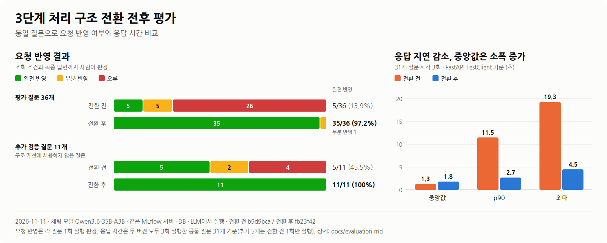

# 3단계 처리 구조 전환 전후 평가

[README](../README.md#구조-변경-효과)의 요약 수치에 대한 상세 문서입니다. 평가 조건, 판정·집계 기준, 전체 지표, 관찰과 원인 추정, 한계를 정리했습니다. 케이스별 답변 원문은 아래 [관련 자료](#관련-자료)에 링크했습니다.



## 1. 비교 대상

| | 전환 전 | 전환 후 |
|---|---|---|
| 커밋 | `b9d9bca` | `fb23f42` |
| 구조 | LLM이 intent 9개 중 하나를 고르고, 일부 질문은 MLflow MCP 에이전트가 도구를 직접 호출해 답변 | ① 질문 구조화(LLM) → 요청 검증 → ② 원본 조회·계산(코드) → ③ 필요할 때만 설명·요약(LLM) |

## 2. 평가 조건

| 항목 | 내용 |
|---|---|
| 일자 | 2026-11-11 (전환 전 16:21~16:50, 전환 후 17:22, 추가 검증 질문은 두 버전 모두 17:24 실행) |
| 모델 | 채팅 모델 `Qwen3.6-35B-A3B`, temperature 0(질문 구조화) |
| 데이터 | 사내 MLflow 서버 1대(실험 9개), 같은 PostgreSQL. 두 버전 모두 같은 서버·DB·LLM으로 실행했습니다. 실행 사이에 MLflow 데이터가 바뀌지 않았는지는 따로 기록하지 않았습니다. |
| 실행 방식 | `eval/compare_request_parsing.py`가 FastAPI `TestClient`로 `/chat/ask`를 호출합니다. 전환 전 코드는 별도 git worktree에서 같은 스크립트로 실행했습니다. 실행 중인 컨테이너가 아니라 한 프로세스 안에서 측정했습니다. |
| MCP | 조회 도구만 열었습니다(삭제 요청 질문으로 실제 삭제가 일어나지 않도록). |

## 3. 질문 세트

| 세트 | 개수 | 구성 | 실행 횟수 |
|---|---|---|---|
| 평가 질문 | 36 | 처음 만든 31개 + 전환 작업 중 추가한 5개(C05, C06, M2-3, M4-1, M4-2). 유형: 개수·답변 범위, 정렬·필터, 복합 요청, 모호·미지원, 멀티턴 | 처음 31개는 두 버전 모두 3회. 추가 5개는 전환 전 1회, 전환 후 3회 |
| 추가 검증 질문(홀드아웃) | 11 | 전환 작업을 마친 뒤 새로 만든 질문. 프롬프트나 코드 수정에 사용하지 않았습니다. | 두 버전 모두 1회 |

**요청 반영은 36개, 응답 시간은 31개인 이유:** 추가 5개는 전환 전 버전에서 1회만 실행했습니다. 응답 시간은 두 버전을 같은 조건(같은 질문, 각 3회)으로 비교해야 하므로, 두 버전 모두 3회 실행한 공통 31개 질문(93건)만 사용했습니다.

## 4. 판정 기준

요청의 의미 차이(대상, 개수, 기간, 필터, 정렬, 답변 범위)가 **조회 조건과 최종 답변 모두**에 반영됐는지를 사람이 판정했습니다. 질문 해석 단계만 본 정확도가 아닙니다.

| 판정 | 기준 |
|---|---|
| 완전 반영 | 조회 조건과 답변 범위가 모두 요청과 일치 |
| 부분 반영 | 조회는 맞지만 답변 범위가 다르거나 답변 품질에 문제가 있음 |
| 오류 | 조회 조건이나 결과가 틀림, 또는 답하지 못함 |

각 질문의 1회차 답변으로 판정했습니다.

## 5. 결과

| 지표 | 전환 전 | 전환 후 | 집계 기준 |
|---|---|---|---|
| 완전 반영 — 평가 질문 | 5/36 (13.9%) | **35/36 (97.2%)** | 1회차 판정. 전환 후 나머지 1개는 부분 반영 |
| 완전 반영 — 추가 검증 질문 | 5/11 (45.5%) | **11/11 (100%)** | 1회 판정 |
| 응답 시간 중앙값 | 1.3초 | 1.8초 | 공통 31개 × 3회 = 93건, `/chat/ask` 왕복 |
| 응답 시간 p90 | 11.5초 | **2.7초** | 위와 같음 |
| 응답 시간 최대 | 19.3초 | 4.5초 | 위와 같음 |
| MCP 에이전트 경유 비율 | 22% | 0% | 93건 중 MCP 경로로 간 비율 |
| 질문당 LLM 호출 | 1.35회 | 1.10회 | 93건 평균. 세션 제목 생성 제외. MCP 에이전트 내부 호출은 별도 클라이언트라 집계되지 않아 전환 전 값은 실제보다 적습니다. |
| 질문 구조화 결과 3회 일치 | — | 36/36 | 같은 질문 3회 실행 시 해석 JSON이 모두 같은 질문 수 |
| 답변 3회 일치 | — | 33/36 | 나머지 3개는 LLM이 쓰는 요약·평가·보고서 답변 |
| 리포트 수치 일치율 | — | **평가 예정** | 보고서 본문 숫자와 MLflow 원본 대조 |

## 6. 관찰한 차이

데이터에서 확인한 사실만 적습니다.

- 전환 전 오답 26개에는 여러 유형이 섞여 있었습니다. 해석한 개수·정렬을 실행에서 무시한 경우("가장 오래된 실험" → 최근 5개), metric 이름 불일치(`val_acc`라고 물으면 "val_acc가 없습니다"), 실험명이 빠져 "조회할 실험이 없습니다"로 끝난 경우, 이전 턴의 조건이 남아 다음 질문을 망친 경우입니다.
- 전환 후 유일한 부분 반영(A11, "carefree-moth-973 run 학습 잘 된 편이야?")은 결론과 근거 순위는 맞았습니다. 다만 3회 중 2회 첫 문장에 "과적합 가능성"과 "일반화 양호"가 함께 나왔습니다.
- 응답 시간 중앙값은 0.4~0.5초 늘었고, p90과 최대는 크게 줄었습니다. MCP 에이전트 경유는 22%에서 0%가 됐습니다.

### 같은 질문의 전후 비교 (C01)

질문: "Timm Hub에서 val_acc 기준 최고 run과 최저 run을 비교해줘"

| | 전환 전 (MCP 에이전트) | 전환 후 (3단계 구조) |
|---|---|---|
| 처리 | LLM이 `describe_run`을 4번 호출해 값을 직접 읽고 문장으로 비교 | ① 구조화 1회 → ② 조회 2회(`list_experiment_names`, `get_runs`) → 비교표를 바로 응답 |
| 답변 | "검증 정확도에서 약 1.09% (capricious-moth-486이 loud-gnat-654에 비해 훨씬 낮음, *참고: 실제 데이터상으론 capricious가 더 높음*)" | 비교표 + "`val_acc` 차이 = +0.0109 (capricious-moth-486가 더 높음)" |
| 판정 | 부분 반영: 값은 맞게 읽었지만 해석이 스스로 모순됨 | 완전 반영 |

## 7. 원인 추정

아래는 위 결과를 설명하는 가설입니다. 별도 실험으로 검증하지 않았습니다.

- **p90·최대 감소:** LLM이 MCP 도구를 여러 번 호출하던 경로가 없어졌기 때문으로 봅니다(MCP 경유 22% → 0%와 같은 시점의 변화).
- **중앙값 증가:** 질문 구조화 프롬프트에 예시 26개를 넣어 입력이 길어졌기 때문으로 봅니다. 예시를 줄여 다시 재면 확인할 수 있습니다.
- **요청 반영 향상:** 해석한 조건을 코드가 그대로 실행하고, metric 이름을 실제 컬럼에 매칭하고, 모호하면 되묻도록 바뀐 영향이 큰 것으로 봅니다.

## 8. 한계

- **질문과 개선을 같은 사람이 만들었습니다.** 프롬프트 예시에는 평가 질문의 문장과 실험·run 이름을 쓰지 않았고 추가 검증 질문을 따로 돌렸지만, 다른 사용자가 만든 질문으로 다시 확인해야 합니다.
- **표본이 작습니다.** 사내 MLflow 실험 9개, 질문 47개입니다.
- **실제 서비스 경로가 아닙니다.** `TestClient`로 측정했으므로 컨테이너 간 네트워크 지연은 포함되지 않았습니다.
- **평가하지 않은 경로:** UI에서 선택한 실험·metric으로 빈 조건을 채우는 경로, MCP 보조 경로, 질문 구조화 JSON이 깨졌을 때의 처리.
- **보고서 수치:** 보고서 본문의 차이·변화율은 LLM이 계산합니다. 수치 일치율은 아직 측정하지 않았습니다.

## 9. 관련 자료

| 문서 | 내용 |
|---|---|
| [request_parsing_comparison.md](../eval/results/request_parsing_comparison.md) | 문제 유형별 대응과 **케이스별 판정표** (3장) |
| [request_parsing_answers.md](../eval/results/request_parsing_answers.md) | 케이스별 해석 결과, 호출한 도구, 답변 원문(전후 나란히) |
| [request_parsing_baseline.md](../eval/results/request_parsing_baseline.md) | 전환 전 기준선 분석 |
| [request_parsing_prompts.md](../eval/results/request_parsing_prompts.md) | 전후 프롬프트 전문 |
| `eval/results/request_parsing_*.json` | 원본 실행 기록(질문별 응답 시간, 호출 기록, 답변) |

## 10. 다시 실행하기

```bash
# 전환 후 (현재 코드)
python eval/compare_request_parsing.py --label after
python eval/compare_request_parsing.py --label holdout_after --cases request_parsing_holdout

# 전환 전 (별도 worktree)
git worktree add --detach ../head-wt b9d9bca
python eval/compare_request_parsing.py --label head --code-root ../head-wt
```
