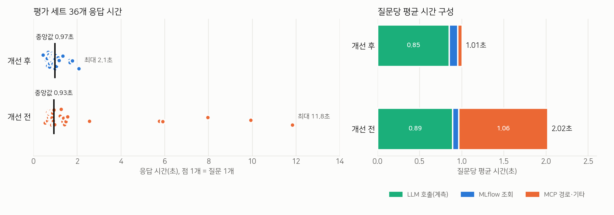

# 운영 리소스 분석 — 요청 해석 구조 개선 전/후

- 측정일: 2026-11-13 14:11~14:25 (KST)
- 개선 전: `3db4d47`(intent 분류 방식). 개선 후: `main`(`3b32012`, 요청 구조 해석 방식)
- 판정(요청 반영 여부)은 [request_parsing_comparison.md](../request_parsing_comparison.md)의 2026-11-11 판정을 이어 쓴다. 오늘 실행한 파서 출력이 그날과 모두 같았기 때문이다(아래 1-3).

## 0. 요약

| 항목 | 개선 전 | 개선 후 |
|---|---|---|
| 요청 반영(✅) — 평가 36 / 홀드아웃 11 | 5 / 5 | 35 / 10 → 수정 후 11 (H07 500 오류, 4-1에서 수정) |
| 응답 시간 중앙값 / p95 / 최대 (평가 36) | 0.93 / 8.46 / 11.8초 | 0.97 / 1.69 / 2.1초 |
| 질문당 평균 응답 시간 | 2.02초 | 1.01초 |
| MCP 경로로 넘어간 질문 | 7/36 (19%) | 0 |
| 질문당 LLM 호출(세션 제목 제외 / 포함) | 1.36 / 2.19회 + MCP 에이전트 호출(미계측) | 1.11 / 1.94회 |
| 질문당 LLM 입력 토큰(세션 제목 포함) | 약 1,530 + MCP 에이전트(미계측) | 약 2,690 |
| GPU | 공유 llama-server(GPU 5, 47.6GB 상주). 부하 시 사용률 평균 31% | 같음. 평균 25% |

- 응답 시간: 중앙값은 비슷하다. 하지만 개선 후에는 6~12초가 걸리던 MCP 경로가 사라져 평균이 절반이 됐고, 최대도 11.8초에서 2.1초로 줄었다.
- 비용: 해석 프롬프트가 길어져(예시 26개) 질문당 LLM 입력 토큰은 약 1.8배가 됐다. llama-server의 프롬프트 캐시 덕분에 해석 호출 시간은 0.39초에서 0.44초로 거의 늘지 않았다.
- 리소스: 프로젝트 자체 컨테이너(backend·frontend·mlflow·postgres·pgadmin)는 메모리를 합쳐 약 2.1GB 쓰고 CPU는 거의 쓰지 않는다. 실질적인 자원은 LLM 서버(GPU 47.6GB)가 차지한다.
- 가장 큰 병목은 동시성이다. LLM 서버(`--parallel 1`)와 백엔드(async 핸들러 안에서 동기 호출, 워커 1개) 양쪽에서 요청이 직렬로 처리된다. 동시 요청 4개를 보내면 마지막 요청은 3.4초를 기다린다.

## 1. 평가 환경과 방법

### 1-1. 환경

| 구분 | 내용 |
|---|---|
| 서버 | Xeon Platinum 8480C 2소켓(224 스레드), RAM 2TB, H100 80GB × 8. 다른 팀 서비스와 함께 쓰는 서버다(측정 중 load average 약 14.5) |
| 디스크 | `/` 1.8TB 중 1.2TB 사용(68%) |
| 챗봇 LLM | `Qwen3.6-35B-A3B` Q8 GGUF. 공유 llama-server(GPU 5, 포트 9983 → 10003). `-c 524288 --parallel 1`. 다른 팀이 운영한다 |
| 보고서 LLM | `gemma-4-26B-A4B-it` Q8. 공유 llama-server(GPU 7, 포트 9980 → 10001). 이번 측정에서는 호출하지 않았다 |
| 프로젝트 컨테이너 | backend(FastAPI, uvicorn 워커 1개), frontend(Streamlit), mlflow v3.12.0(SQLite, `--workers 1`), postgres 18, pgadmin |
| MLflow 데이터 | 실험 10개(활성 9개), run 73개, metric 4,584행 |

### 1-2. 방법

1. 대기 상태: 요청 없이 60초 동안 1초 간격으로 리소스를 샘플링했다.
2. 부하 상태: [measure_run.py](measure_run.py)로 평가 세트 36개와 홀드아웃 11개를 개선 후 → 개선 전 순서로 한 번씩 실행했다. `eval/compare_request_parsing.py`와 같은 방식(FastAPI `TestClient`로 `/chat/ask` 호출, MCP는 조회 도구만 허용)이고, LLM 호출별 시간·토큰(usage)과 MLflow 조회 함수 시간을 추가로 기록한다.
   - 개선 전 코드는 현재 DB에서 돌지 않는다. `chat_messages.intent` 컬럼이 이미 삭제됐기 때문이다. 그래서 같은 postgres에 임시 DB(`ops_eval_head`)를 만들어 측정하고 삭제했다. 운영 DB는 건드리지 않았다.
3. 실행하는 동안 [sampler.py](sampler.py)가 1초 간격으로 다음을 기록했다: `docker stats`(컨테이너 CPU·메모리), `nvidia-smi`(GPU 5·7), `/proc`(llama-server와 측정 프로세스 CPU·RSS).
4. 동시성: 실제 backend 컨테이너(:8010)에 동시 요청 1·2·4개를 보냈고, LLM 서버에 해석 프롬프트 크기(약 6.4k 토큰) 요청을 동시에 보냈다.
5. 저장 공간: 이미지·볼륨·DB 크기·MLflow 저장소·컨테이너 로그 크기를 확인했다.

### 1-3. 측정의 한계

- 측정 시점에 Qwen 서버에는 다른 트래픽이 없었다(작업 카운터가 몇 분간 변하지 않음). 11-11 측정보다 응답이 전체적으로 약 30~45% 빨랐다(개선 후 중앙값 1.73초 → 0.97초, 개선 전 1.32초 → 0.93초). 공유 서버의 그때그때 부하에 따라 절대값이 달라진다는 뜻이다. 그래서 전/후 비교는 같은 시각에 잰 오늘 값을 기준으로 한다.
- 개선 전 MCP 경로에서 OpenAI Agents SDK가 직접 부르는 LLM 호출은 계측되지 않는다. 개선 전의 LLM 호출 수와 토큰은 **하한값**이다.
- 측정은 TestClient(같은 프로세스)로 했다. 그래서 부하 시 backend 메모리는 측정 프로세스 값(최대 296MB)으로 대신했다.
- 파서 출력 재현성: 개선 후 36/36과 11/11, 개선 전 31/31과 11/11이 11-11과 같았다. 답변이 달라진 것은 LLM이 문장을 쓰는 케이스(A10, A11, C04), 개선 전 MCP 케이스, 그리고 H07(4-1의 버그)뿐이다.

## 2. 개선 전/후 비교



### 2-1. 요청 반영률 (11-11 판정 + 오늘 재현 확인)

| | ✅ | △ | ❌ |
|---|---|---|---|
| 평가 36 — 개선 전 | 5 | 5 | 26 |
| 평가 36 — 개선 후 | 35 | 1 | 0 |
| 홀드아웃 11 — 개선 전 | 5 | 2 | 4 |
| 홀드아웃 11 — 개선 후 | 10 → 수정 후 11 | 0 | 1 → 수정 후 0 (H07: 11-12 커밋 이후 500 오류, 4-1에서 수정) |

### 2-2. 응답 시간

| 세트 | 버전 | 중앙값 | p90 | p95 | 최대 | 평균 | 합계 |
|---|---|---|---|---|---|---|---|
| 평가 36 | 개선 전 | 0.93초 | 5.82 | 8.46 | 11.83 | 2.02 | 72.8초 |
| 평가 36 | 개선 후 | 0.97초 | 1.50 | 1.69 | 2.07 | 1.01 | 36.2초 |
| 홀드아웃 11 | 개선 전 | 0.85초 | 1.82 | 5.22 | 8.62 | 1.71 | 18.9초 |
| 홀드아웃 11 | 개선 후 | 0.87초 | 1.26 | 1.34 | 1.42 | 0.90 | 9.9초 |

11-11 측정(평가 세트 × 3회)도 경향이 같다. 개선 전은 중앙값 1.32초에 최대 19.3초, 개선 후는 중앙값 1.73초에 최대 4.5초였다. 3회 사이의 편차는 개선 후가 훨씬 작았다(합계 67.3~67.4초 대 98.0~106.3초).

개선 전의 느린 꼬리는 모두 MCP 경로였다.

| 케이스 | 응답 시간 | MCP 도구 호출 | 그중 계측된 LLM 시간 |
|---|---|---|---|
| C04 | 11.8초 | 6회 | 1.1초 |
| C01 | 9.9초 | 6회 | 1.0초 |
| C03 | 8.0초 | 4회 | 1.2초 |
| D03 | 5.9초 | 2회 | 0.9초 |
| D01 | 5.7초 | 0회 | 0.7초 |

MCP 경로는 요청마다 MCP 서버(`python -m mlflow mcp run`) 프로세스를 새로 띄운다. 따로 재 보니 띄우는 데 **2.8~3.6초**가 걸렸다(도구 목록 조회와 `search_experiments` 호출은 0.07초). 나머지 시간은 에이전트의 LLM 턴이다.

### 2-3. 시간 구성 (질문당 평균)

| | LLM(계측) | MLflow 조회 | MCP 경로·기타 | 합계 |
|---|---|---|---|---|
| 개선 전 | 0.89초 (44%) | 0.04초 (4%) | 1.06초 (52%) | 2.02초 |
| 개선 후 | 0.85초 (84%) | 0.10초 (10%) | 0.05초 (5%) | 1.01초 |

개선 후의 응답 시간은 대부분 LLM 호출 두 번이다. 해석 호출에 0.44초, 세션 제목 생성에 0.39초가 걸린다(2-4).

### 2-4. LLM 호출량과 토큰

| 호출 종류 | 개선 전 횟수 (36문항) | 평균 시간 | 평균 입력/출력 토큰 | 개선 후 횟수 | 평균 시간 | 평균 입력/출력 토큰 |
|---|---|---|---|---|---|---|
| 요청 해석 | 36 (intent 파서) | 389ms | 1,205 / 22 | 36 (요청 구조 파서) | 435ms | 2,487 / 30 |
| 검색 필터 2차 파서 | 11 | 407ms | 626 / 25 | — | | |
| 답변 생성(run 해석·요약·평가·보고서) | 2 | 1,232ms | 632 / 140 | 4 | 667~1,129ms | 596~1,162 / 56~126 |
| 세션 제목 생성 | 30 | 370ms | 116 / 11 | 30 | 389ms | 146 / 12 |
| MCP 에이전트 | 7문항(미계측, 턴마다 도구 25개 스키마 포함) | | | 0 | | |
| **질문당 합계** | **2.19회 + α** | | **약 1,530 + α 토큰** | **1.94회** | | **약 2,690 토큰** |

- 해석 프롬프트가 1.2k에서 2.5k 토큰으로 두 배가 됐다. 그래도 시스템 프롬프트가 매번 같아 llama-server 프롬프트 캐시에 맞으므로, 해석 호출 시간은 46ms만 늘었다.
- 세션 제목 생성은 첫 질문마다 요청 경로 안에서 동기로 실행된다([chat_router.py:180](../../../backend/app/api/chat_router.py#L180)). 새 세션 첫 질문 응답 시간의 약 38%(전체 평균으로는 약 32%)를 차지한다.

## 3. 운영 환경 리소스 사용 현황

### 3-1. CPU·메모리 (1초 샘플)

| 대상 | 대기 상태 | 부하 상태(개선 후) | 부하 상태(개선 전) |
|---|---|---|---|
| backend 컨테이너 | CPU 평균 1.0%, 메모리 225MB | (측정 프로세스) CPU 평균 64%, 순간 최대 944%, RSS 최대 296MB | MCP 경로마다 MCP 서버 자식 프로세스 +281MB |
| frontend 컨테이너 | 0.6%, 222MB | 같음 | 같음 |
| mlflow 컨테이너 | 1.5%, 1.38GB | 평균 7.6%, 최대 31.6%, 1.38GB | 평균 5.2%, 최대 24.4% |
| postgres 컨테이너 | 0.6%, 57MB | 평균 1.2%, 60MB | 평균 0.3%, 77MB |
| pgadmin 컨테이너 | 0.1%, 250MB | 같음 | 같음 |
| Qwen llama-server | CPU 0%, RSS 13.4GB | CPU 평균 74%(코어 1개 상한) | 평균 66% |

- 측정 프로세스의 순간 CPU 944%는 시작할 때 모듈을 불러오는 순간이다. 질문을 처리하는 동안은 대부분 LLM 응답을 기다린다.
- 프로젝트 컨테이너 5개의 메모리 합계는 약 2.1GB다. 그중 mlflow 서버가 1.38GB로 가장 크다.

### 3-2. GPU

| GPU | 용도 | 메모리 | 대기 | 부하(개선 후) | 부하(개선 전) |
|---|---|---|---|---|---|
| 5 | Qwen3.6-35B-A3B (챗봇) | 47.6GB 상주 | 사용률 0%, 109W | 평균 25%, 최대 73%, 최대 214W | 평균 31%, 최대 79%, 최대 271W |
| 7 | gemma-4-26B (보고서) + 다른 모델 1개 | 76.1GB (gemma 33.8GB) | 0% | 호출 없음 | 호출 없음 |

- GPU 메모리는 요청이 없어도 상주한다. 47.6GB의 대부분은 컨텍스트 524k 토큰용 KV 캐시다. 챗봇 요청 하나의 입력은 3k 토큰 미만이다.
- 두 LLM 서버 모두 다른 팀이 운영하는 공유 자원이다. 이 프로젝트가 단독으로 쓰지 않는다.

### 3-3. 저장 공간

| 항목 | 크기 | 비고 |
|---|---|---|
| backend / frontend 이미지 | 1.06GB / 1.06GB | 오늘 13:16 빌드 |
| mlflow / postgres / pgadmin 이미지 | 824MB / 457MB / 538MB | |
| postgres 데이터 | 64MB (`mlflow_llm` DB 8.8MB) | chat_messages 348행, chat_sessions 54행, reports 7행 |
| MLflow 저장소 `/home/dyyu/MLflow` | 3.8GB | runs 947MB, artifacts 719MB, data 423MB, mlflow.db 2.8MB, `.git` 1.7GB |
| 컨테이너 로그 | mlflow 11.9MB, pgadmin 5.8MB, 나머지 0.1MB 미만 | json-file 드라이버, **로테이션 설정 없음** |

## 4. 주요 병목과 운영 부담

### 4-1. [버그·수정함] 실험 상세 조회가 500 오류

- [chat_request.py:1135-1139](../../../backend/app/services/chat_request.py#L1135-L1139)가 `(답변, "get_experiment", metadata)` 3개짜리 튜플을 반환한다. 라우터는 `answer, metadata = result`로 2개를 받으므로 `ValueError`가 난다.
- intent 제거 커밋(`64cafb9`, 11-12)에서 생긴 흔적이다. 11-11 측정에서는 H07이 정상이었다.
- 영향: "○○ 실험 정보 알려줘"처럼 실험 이름을 지정한 조회 전체. 현재 backend 컨테이너도 같은 코드다.
- 수정(2026-11-13, 미커밋·컨테이너 미재빌드): 가운데 `"get_experiment",` 줄을 지웠다. 다시 실행한 결과 평가 세트 36개와 홀드아웃 11개가 모두 200이었다. H07 답변은 11-11의 ✅ 답변과 같다. 다른 답변 중 달라진 것은 LLM이 문장을 쓰는 A10, A11, C04뿐이다. 같은 형태의 잘못된 반환은 더 없다(`tuple[str, dict]` 반환 함수 전체 AST 검사).
- 평가 세트에는 이 경로가 없어서 놓쳤다. 평가 세트에 H07 유형을 추가할 것을 권한다.

### 4-2. 동시 요청이 직렬로 처리됨 — 가장 큰 운영 병목

backend 컨테이너에 같은 종류의 질문을 동시에 보낸 결과

| 동시 요청 | 요청별 응답 시간 | 전체 |
|---|---|---|
| 1 | 0.72초 | 0.72초 |
| 2 | 0.73, 1.45초 | 1.45초 |
| 4 | 0.76, 1.42, 2.41, 3.45초 | 3.46초 |

직렬화가 두 곳에서 일어난다.

1. **LLM 서버 `--parallel 1`**: 해석 프롬프트 크기의 요청 4개를 동시에 보내면 1.1 / 2.2 / 3.4 / 4.6초가 걸린다. 다른 팀의 요청도 같은 줄에 선다.
2. **backend 이벤트 루프 차단**: `async def chat_with_experiment` 안에서 동기 함수(`answer_request` → 동기 OpenAI·MLflow 호출)를 그대로 부른다. uvicorn 워커도 1개다. 그래서 채팅 하나를 처리하는 동안 다른 API가 모두 멈춘다. 채팅 처리 중에 `/health`를 부르면 0.01초가 아니라 1.74초가 걸렸다.
   - 이것은 docker healthcheck(`timeout=3`)에도 걸린다. 4~5초 이상 걸리는 처리(보고서 Q&A, 긴 요약)가 이어지면 healthcheck가 실패할 수 있다.

개선안(효과가 큰 순서)

- 라우터를 `def`로 바꾸거나(FastAPI 스레드풀에서 실행됨) `run_in_threadpool`로 감싼다. 코드 몇 줄이면 된다.
- 세션 제목 생성을 응답 뒤 백그라운드 작업(`BackgroundTasks`)으로 옮긴다. 새 세션 첫 질문 응답이 약 0.39초(약 38%) 줄어든다.
- LLM 서버의 `--parallel`을 늘려 달라고 운영 팀에 요청한다. 이 서버가 공유 서버라 직접 바꿀 수는 없다. 요청 입력이 3k 토큰 미만이므로 컨텍스트를 줄이고 슬롯을 늘려도 충분하다.

### 4-3. 남은 MCP 경로의 비용

개선 후 평가 세트에서는 MCP 경로로 가는 질문이 없다. 하지만 요청 구조로 표현할 수 없는 질문(trace 등)은 여전히 MCP로 간다. 이 경로는 요청마다 다음 비용이 든다.

- MCP 서버 프로세스 기동 2.8~3.6초, 메모리 +281MB
- 도구 25개 스키마가 들어간 에이전트 LLM 턴 여러 번(미계측)

MCP 서버를 앱 수명 동안 한 번만 띄워 재사용하면 기동 비용이 사라진다.

### 4-4. 운영 부담

| 항목 | 내용 | 권장 |
|---|---|---|
| 외부(공유) LLM 의존 | 챗봇·보고서 LLM 모두 다른 팀이 운영한다. 그쪽에서 모델을 교체하거나 재시작하면 바로 장애가 난다. 응답 속도도 공유 부하에 따라 30~45% 흔들린다(1-3) | `.env`의 모델 이름과 서버 별칭(`qwen3.6:35b_A3B`)이 다르다. 지금은 단일 모델 서버라 동작하지만, 모델을 교체할 때 확인할 항목이다. LLM 연결 실패 시 응답 문구를 정해 둔다 |
| MLflow 서버 | SQLite 백엔드에 `--workers 1`. 지금 데이터 규모(run 73개)에서는 조회가 질문당 0.1초라 문제없다 | 사용자나 run이 늘면 postgres 백엔드로 옮기는 것을 검토한다 |
| 로그 로테이션 없음 | mlflow 로그가 4주에 11.9MB다. 당장은 작지만 무한히 쌓인다 | compose에 `logging: {driver: json-file, options: {max-size: 10m, max-file: 3}}`를 추가한다 |
| DB 스키마 관리 | `intent` 컬럼은 수동으로 삭제됐고, `create_all`은 컬럼 변경을 반영하지 않는다. 이 때문에 옛 코드는 지금 DB에서 실행되지 않는다(1-2) | 마이그레이션 도구(Alembic)를 도입하거나 스키마 변경 이력을 문서로 남긴다 |
| 이미지 태그 | `postgres:latest`, `pgadmin4:latest`. 다시 pull하면 메이저 버전이 바뀔 수 있다(postgres 데이터 디렉터리가 이미 `18/`) | 버전을 고정한다(예: `postgres:18`) |
| 회귀 테스트 | 4-1 버그는 평가 세트에 없는 경로에서 생겼다 | 커밋 전에 평가 세트와 홀드아웃을 모두 돌리는 것을 기본 절차로 한다 |

## 5. 다시 실행하는 법

```bash
conda activate mlflow310
cd /home/dyyu/mlflow_LLM_dy
# 개선 후
python eval/results/ops_resource/measure_run.py --label ops_after
python eval/results/ops_resource/measure_run.py --label ops_after_holdout --cases request_parsing_holdout
# 개선 전: 워크트리 + 임시 DB(현재 DB에는 intent 컬럼이 없음)
git worktree add --detach /tmp/head-wt 3db4d47
docker exec mlflow_llm_dy-postgres-1 sh -c 'psql -U $POSTGRES_USER -d $POSTGRES_DB -c "CREATE DATABASE ops_eval_head"'
DATABASE_URL=<.env의 URL에서 DB 이름만 ops_eval_head로> \
  python eval/results/ops_resource/measure_run.py --label ops_head --code-root /tmp/head-wt
docker exec mlflow_llm_dy-postgres-1 sh -c 'psql -U $POSTGRES_USER -d $POSTGRES_DB -c "DROP DATABASE ops_eval_head"'
# 리소스 샘플링(다른 터미널, sampler.py의 llama-server PID를 먼저 확인)
python eval/results/ops_resource/sampler.py samples.jsonl
```

원본 결과: `request_parsing_ops_{after,head}{,_holdout}.json`(이 폴더)
